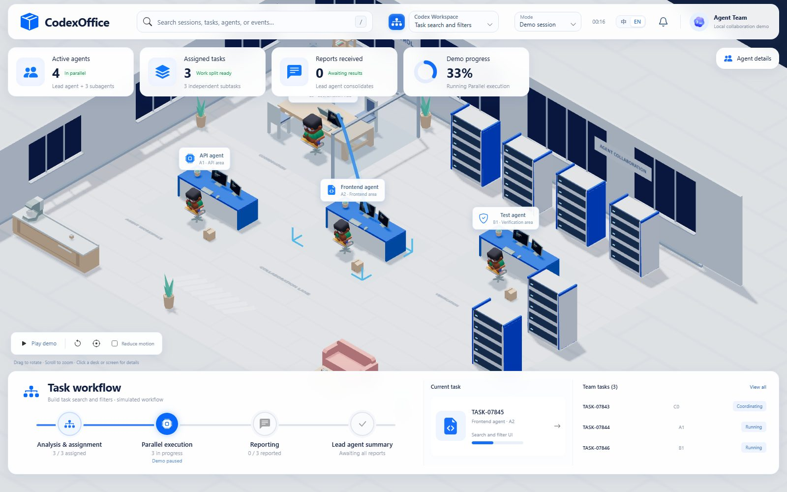
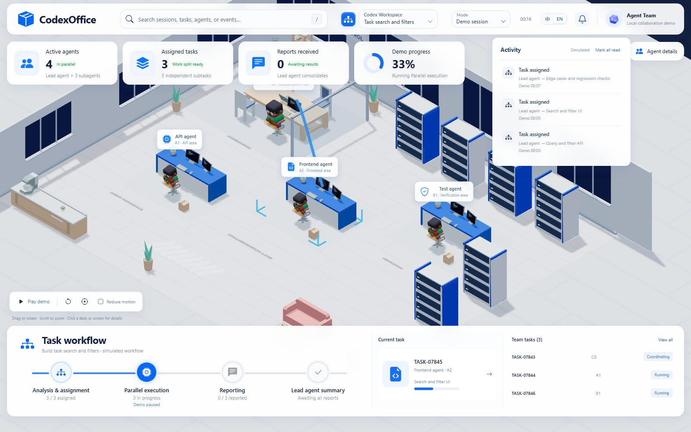

# dsh-mutipleagent

English · [简体中文](README.md)

A 3D office for DeepSeek Harness multi-agent work. Every conversation page grows a **Multi-Agent Office** tab next to Chat / Trajectory / Context — open it and the office is already showing that conversation, with no workspace or session picker in the way. The sidebar entry stays for cross-project browsing.

**Read-only.** It never starts, pauses or approves tasks, never calls a model, never writes to a session, and never sends anything off the machine.

| Task detail | Activity feed |
| --- | --- |
|  |  |

Generated from demo data with `npm run screenshots`. The interface ships in Chinese and English — switch with the 中 / EN control in the top bar. In live mode, task text, agent names and event previews stay exactly as they appear in your session logs, so they are not translated.

Current version `v0.4.0`, package `dsh-mutipleagent`. Compatible with DeepSeek Harness `^0.2.2-rc.1` and Node.js `^22.19.0 || >=24.0.0`. See [CHANGELOG.md](CHANGELOG.md) for per-version notes and [Releases](https://github.com/lkuliuying/dsh-mutipleagent/releases) for the published notes.

## What's new in v0.4.0

- The office now fills a whole floor: a 4 × 3 grid of face-to-face pods (24 seats) where the lead agent and the first sub-agent share a table and sit across from each other, with back-to-back monitors down the middle and each side's keyboard, mouse and side screen facing its own seat. The room also gains a glass meeting room, equipment racks, bookshelves, a kitchen counter and a lounge corner.
- Hide everything but the scene: click the button in the scene toolbar (or press `H`) to collapse the top bar, stat cards, agent details and the workflow dock; use the "Show panels" pill or press `Esc` to bring them back. The choice is stored locally and survives reloads.
- The camera is pulled back and centred so the whole floor is in frame, and the outdoor ground now matches the background colour, so the office no longer floats on a hard-edged slab and the bottom row of desks stays clear of the workflow dock.

## What's new in v0.3.1

- Opening the Multi-Agent Office tab hides the conversation composer, and returning to Chat restores it — the picture gains a whole block of height.
- Embed mode also drops the office's own top bar (search, Session dropdown, clock, bell); the collaboration stats and Agent details move up to the top of the tab.
- Inside the details panel the primary action and the "view screen / view task source" links now sit right under the header, so nothing needs scrolling; the footer note and the scene drag hint are gone, and the workflow caption is clamped to one line.

## What's new in v0.3.0

- The office is a conversation view: it registers `conversation.view` and sits in the tab row beside Chat / Trajectory / Context, folding into the "More views" menu when the row is narrow. No panel-first, no picking a directory and then a session.
- Opening the tab pins the current session: the frame loads with `?mode=live&source=harness&rootId=<session id>&embed=1`, the directory picker is hidden and the title becomes the session title. Switching conversation or tab reloads the frame for the new session, and a session missing from the default root list (sub-agents, for example) falls back to the full list instead of failing.
- Embed mode trims the chrome the host already provides: brand, mode switch, language switch and account section are hidden, leaving search, sessions and notifications.
- The sidebar entry and the global panel are unchanged.

## What's new in v0.2.1

- Reads only expand what actually changed: `sessionQuery.observeSession()` leases hand back the header and the log cursor, and events materialize on demand. A session whose cursor did not move is neither cloned nor re-folded; `/api/health` reports the reuse count as `reused`.
- Sessions without a live instance are gated by the persistence revision, so an unchanged log is not re-read; when observation is unavailable the reader falls back to the full `readSession()`.

## What's new in v0.2.0

- Chinese and English UI, following the system language by default, switchable in the header.
- Faster first paint and lighter reads: furniture plus three characters load first, `app.js` drops from 731.6 KB to 10.5 KB and `demo.js` from 814 KB to 73.4 KB (one shared `three.js` chunk, gzip on), and unchanged sessions are no longer re-folded every second.
- Static files serve `ETag` / `304` and gzip; polling stops when no page is connected and refreshes on open.
- `/api/health` reports version, uptime, client count, read cost and polling state.
- Tooling: ESLint, Prettier, `.gitattributes`, CI (Node 22.19 / 24, browser acceptance, build freshness) and `npm run release`.

## Install

### From npm

The package is published to [npm](https://www.npmjs.com/package/dsh-mutipleagent); the npm version matches the plugin version:

    dsh plugin --profile desktop add 'dsh-mutipleagent@0.2.1' --ignore-scripts

Bump the version number when upgrading.

### From a GitHub tag

Quit Harness Desktop completely, then:

    dsh plugin --profile desktop add 'dsh-mutipleagent@https://codeload.github.com/lkuliuying/dsh-mutipleagent/legacy.tar.gz/refs/tags/v0.2.1' --ignore-scripts

If `dsh` is not on `PATH`, use the bundled CLI:

    & 'C:\ProgramSoftware\Deepseek\resources\runtime\cli\bin\dsh.cmd' plugin --profile desktop add 'dsh-mutipleagent@https://codeload.github.com/lkuliuying/dsh-mutipleagent/legacy.tar.gz/refs/tags/v0.2.1' --ignore-scripts

Restart Harness and open **Multi-Agent Office** from any conversation's tab row (or from the sidebar for the cross-project view). No API key, no separate server, nothing else to configure.

To build from source instead:

    npm ci
    npm run build
    npm pack --ignore-scripts
    dsh plugin --profile desktop add "F:\path\to\dsh-mutipleagent-0.1.3.tgz"

## What you get

- **Desks, not dashboards.** Agents sit down, face their monitor and type; screens show current status and the latest event. Task hand-offs and reports travel as light trails from screen to screen.
- **Screen detail.** Click any monitor for the real agent, status, task, model/tool and recent events. Esc, overlay and a close button all work; narrow screens switch to a readable text layout.
- **Session picker, when you want it.** The sidebar view asks for a workspace directory, then a session inside it. Search by path, title, time or short ID; identical titles stay distinguishable. Your last choice is remembered.
- **Notification centre.** Unread dot clears against a read anchor, with "mark all read", category icons and a compact three-line summary.
- **Graceful degradation.** Without WebGL the team tree, activity log and reports still work, and "reduce motion" is one checkbox away.
- **Bilingual UI.** Chinese and English, switchable in the header and remembered locally.

## Boundaries

- Data comes only from Harness's public `sessionQuery` interface. No session files, no credentials, no private reasoning or system messages.
- The server binds `127.0.0.1`, serves `GET` only, rejects cross-origin requests and non-loopback hosts, and reuses Harness's owner check when mounted.
- No telemetry, no external fonts, no CDN, no third-party scripts.
- Numbers follow recorded events. Some Desktop builds store `spawn_agent` payloads encrypted, so a hand-off may show "not recorded" rather than an invented description.

Read [SECURITY.md](SECURITY.md) for the full threat model and how to report a vulnerability privately.

## FAQ

**Only the root agent shows up.** The plugin only renders sub-agents that actually existed. Ask for parallel work in the session (for example "spawn two read-only sub-agents, one for the API contract and one for test gaps") and let it run.

**Numbers differ from what I saw in the session.** Logs are written per message block, not per token; known sessions are checked roughly once a second and new ones every five seconds. Missing data is shown as "not recorded" instead of a guess.

**Does it upload my sessions?** No. See the boundaries above and [SECURITY.md](SECURITY.md).

**Port 4317 is taken.** `node src/server.js --port 4320 --open`, or use the plugin panel which has no fixed port.

## Develop

    npm ci
    npm run build
    npm test
    npm run lint && npm run format:check && npm run check:compat

`npm run test:ui` drives the real WebGL page with Playwright. `npm run screenshots` regenerates the images above. `npm run release -- 0.2.0` bumps versions, runs every gate, commits and tags; GitHub Actions then publishes the release.

Source layout: `src/` is the read-only server and session parsing, `web/` is the UI and 3D scene, `vendor/` is pinned upstream rendering code, `assets/` holds models and images. See [CONTRIBUTING.md](CONTRIBUTING.md) before sending a PR.

## Licence

Based on [Charonyuu/whatsmyagentdoing](https://github.com/Charonyuu/whatsmyagentdoing) (commit `c69bf2bc98cf96a63d146070e9bbc83b507bf0bf`, v0.8.1); upstream MIT licence kept in [LICENSE](LICENSE). Character and furniture models are Kenney Mini Characters and Furniture Kit (CC0), original licences under `assets/kenney`. Full attribution in [THIRD_PARTY_NOTICES.md](THIRD_PARTY_NOTICES.md).
