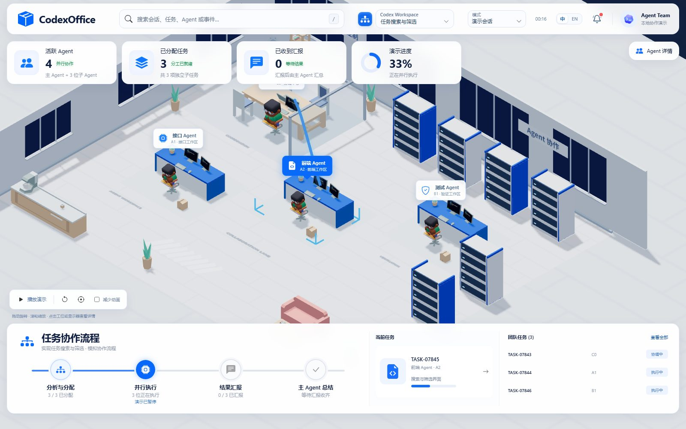
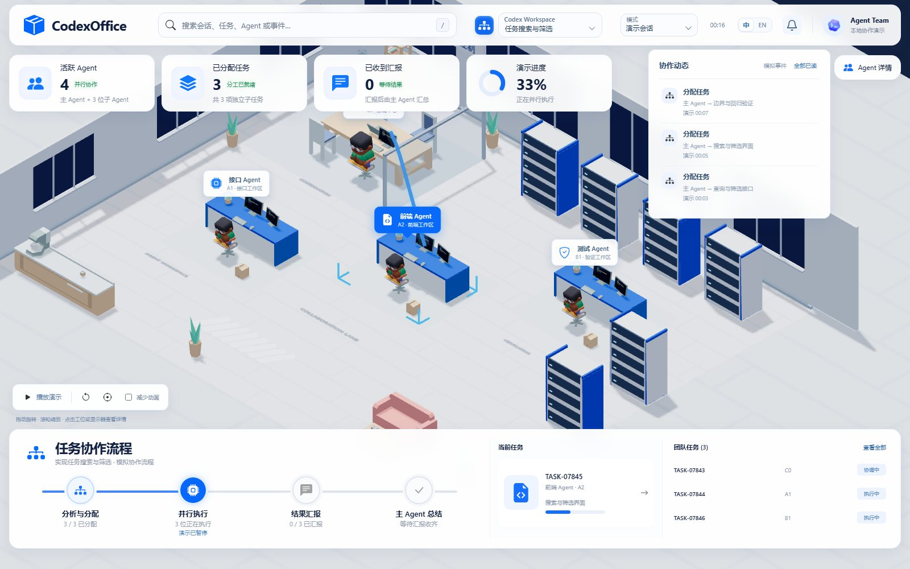

# dsh-mutipleagent

[English](README.en.md) · 简体中文

DeepSeek Harness 多 Agent 3D 协作办公室插件。安装后从 Harness 侧栏的「多 Agent 办公室」打开，观察真实主会话、子 Agent、工具活动和完整汇报，沿用本项目已有的 3D 场景与交互。

**只读**：不启动任务、不调用模型、不审批、不修改会话，也不把任何内容发到本机以外。

| 任务详情 | 协作动态 |
| --- | --- |
|  |  |

以上为 `npm run screenshots` 生成的演示画面（演示数据，非真实会话）。

当前版本为 `v0.2.0`，包名为 `dsh-mutipleagent`，仓库地址为 [lkuliuying/dsh-mutipleagent](https://github.com/lkuliuying/dsh-mutipleagent)。兼容 DeepSeek Harness `^0.2.2-rc.1`，需要 Node.js `^22.19.0 || >=24.0.0`。

各版本变化见 [CHANGELOG.md](CHANGELOG.md)，发布说明见 [GitHub Releases](https://github.com/lkuliuying/dsh-mutipleagent/releases)。

## v0.2.1 更新

- 读取只展开真正变化的会话：`sessionQuery.observeSession()` 的观察租约只取 header 与日志游标，事件按需物化；游标未变的会话不再克隆整份日志、也不再重新折叠，复用数见 `/api/health` 的 `reused`。
- 未运行的会话按持久化修订号判断，日志没变就直接复用，不重读 zstd 日志；观察不可用时自动回退整份读取。

## v0.2.0 更新

- 中英双语界面，默认跟随系统语言，顶栏可切换。
- 渲染与读取都提速：首屏只等家具和 3 个角色；`app.js` 从 731.6 KB 降到 10.5 KB、`demo.js` 从 814 KB 降到 73.4 KB，three.js 只打一份共享 chunk 并启用 gzip；会话没有新事件时不再重复折叠。
- 静态资源支持 `ETag` / `304` 与 gzip；没有页面连接时停止轮询，打开即刷新。
- `/api/health` 增加版本、运行时长、客户端数、读取耗时与轮询状态。
- 工程化：ESLint、Prettier、`.gitattributes`、CI（Node 22.19 / 24 + 浏览器验收 + 构建产物一致性）、`npm run release` 一键发布。
- 修正演示模式下 `/api/health` 报错、模型未加载完成时的空引用等问题。

完整变更（含 v0.1～v0.1.3）见 [CHANGELOG.md](CHANGELOG.md)，发布说明见 [Releases](https://github.com/lkuliuying/dsh-mutipleagent/releases)。

## 安装到 Harness

### 线上安装与更新

完全退出 Harness Desktop，在 PowerShell 运行以下命令，再重新启动 Harness：

    dsh plugin --profile desktop add 'dsh-mutipleagent@https://codeload.github.com/lkuliuying/dsh-mutipleagent/legacy.tar.gz/refs/tags/v0.2.0' --ignore-scripts

如果终端没有 `dsh` 命令，可使用 Desktop 随附的 CLI：

    & 'C:\ProgramSoftware\Deepseek\resources\runtime\cli\bin\dsh.cmd' plugin --profile desktop add 'dsh-mutipleagent@https://codeload.github.com/lkuliuying/dsh-mutipleagent/legacy.tar.gz/refs/tags/v0.2.0' --ignore-scripts

上述命令既可首次安装，也可把原来固定在 `v0.1`～`v0.1.3` 的安装切换到 `v0.2.0`。安装源固定到具体标签，后续升级需改为目标版本的标签；仅重启不会切换版本。

### 从本地源码打包

在项目目录完成构建与本地打包：

    npm ci
    npm run build
    node -e "require('node:fs').mkdirSync('.artifacts', { recursive: true })"
    npm pack --pack-destination .artifacts --ignore-scripts

退出 Harness Desktop 后，安装本地包；路径按实际位置调整：

    dsh plugin --profile desktop add "F:\Program\Multiple-Agent\.artifacts\dsh-mutipleagent-0.2.0.tgz"

如果终端没有 `dsh` 命令，可使用 Desktop 随附的 CLI，例如 PowerShell：

    & 'C:\ProgramSoftware\Deepseek\resources\runtime\cli\bin\dsh.cmd' plugin --profile desktop add 'F:\Program\Multiple-Agent\.artifacts\dsh-mutipleagent-0.2.0.tgz'

重启 Harness，在侧栏选择「多 Agent 办公室」。不需要单独运行办公室服务，也不需要设置 API Key。插件从 `sessionQuery` 公开接口读取会话，不读取 `.codex`、凭据或私有推理。

也可以从 Git 地址安装最新主分支：

    dsh plugin --profile desktop add https://github.com/lkuliuying/dsh-mutipleagent.git

### 插件行为与边界

- 页面位于宿主的 `/dsh-mutipleagent/` 路由，Web 和 Desktop 共用同源入口；会话接口沿用 Harness 登录校验，仅允许 owner 访问。
- 主会话与真实子 Agent 的关系、状态和正文来自已记录事件。没有百分比时显示「未记录」；子 Agent 结束不代表主任务完成。
- 先选择工作目录，再从该目录选择具体会话。展开下拉后可按完整路径或会话标题、时间、ID 筛选；目录显示完整路径和会话数量，会话分行显示标题、创建时间与短 ID，同名会话也能区分。未记录目录的会话单独归组。
- 记住上次选择的目录和会话；地址中明确指定的会话优先。「跟随新会话」仅跟随当前目录，其他项目的新任务不会抢走显示。窄窗口通过「会话 / 团队」打开同样的目录筛选。
- 可以选择成员、搜索任务、查看任务与汇报全文，或切换到明确标记的模拟演示。后台会话标题最多每 30 秒刷新一次，正在观察的团队随原有轮询更新。
- 搜索与下拉支持方向键、Home / End 和 Enter；下拉中 Escape 取消筛选并返回触发器，Tab 继续切换焦点。任务搜索按 `/` 聚焦，Escape 先收起结果，再按一次清空；清空按钮保留输入框焦点。中文输入法组合期间 Enter 不会提前选择。演示模式使用同样的控件。
- 插件只读观察，不启动任务、不调用模型、不审批、不修改会话。需要在 Harness 会话中实际创建子 Agent 才会出现真实协作。
- 停用或卸载时释放路由、轮询、事件连接和页面资源。构建产物与模型随包提供，不使用 CDN。

插件源码入口为 `harness.cjs` 和 `client.js`；`src/harness-watcher.js` 将公开会话事件转换为办公室快照，`cordis.patch.yml` 负责宿主插件注册。不会安装第二份 Harness 运行时，也未新增 npm 依赖。

插件验证命令：

    npm test
    npm run test:plugin:ui
    npm run smoke:host

`smoke:host` 在隔离进程中使用本机 Desktop 的实际 SDK 和合成会话验证插件加载，不调用模型、不安装插件、不写入用户 profile。可通过 `DSH_DESKTOP_EXE` 指定其他安装路径。

## 独立 Codex 观察器

继续在 Codex Desktop 或 CLI 中执行任务，在本地浏览器观察主 Agent 分配任务、子 Agent 并行执行、提交汇报，以及主 Agent 的最终总结。

这是只读观察器。它不会启动 Codex 任务、修改 Codex 配置、处理审批、调用模型或上传会话内容。

## 开始使用

需要 Node.js 20 或更新版本，以及支持 WebGL 的浏览器。交付目录已包含构建好的页面和全部模型，日常使用不需要安装 npm 依赖，也不需要填写 API Key。

Windows 双击 **启动办公室.cmd**，服务就绪后会打开浏览器：

http://127.0.0.1:4317

也可以在此目录运行：

    node src/server.js --open

保持启动窗口运行；关闭窗口或按 Ctrl+C 停止服务。端口被占用时可以运行：

    node src/server.js --port 4320 --open

默认读取当前用户的 .codex/sessions。自定义数据目录时，在 PowerShell 中设置：

    $env:CODEX_HOME = 'D:\your-codex-home'
    node src/server.js --open

这里填写 Codex 数据目录，不是 sessions 子目录。应用只读该目录中的会话文件，不读取 auth.json 或其他凭据文件。

## 怎么看

- 左侧选择一个主任务，团队树包含它的子 Agent 和后代；完成的成员仍留在团队中。
- 拖动旋转办公室，滚轮缩放；点击人物或团队成员查看详情，点击显示器查看该工位的屏幕详情，点击复位按钮恢复全景。
- 顶部「模式」下拉切换真实会话与演示会话；铃铛查看协作动态，打开面板后红点自动消除，也可点「全部已读」。
- 右侧查看任务原文、实际工具活动、可见进展消息和汇报全文；汇报可展开和复制。
- 底部时间线展示分配、追加指令、等待、汇报、完成和失败。分配用消息流表达；子 Agent 汇报时走向协调区，界面状态立即更新。
- 上次选择的任务与减少动画偏好保存在当前浏览器。首次读取、刷新、切换任务或重连时不播放历史动画。
- 无 WebGL 时仍可使用团队树、活动记录与报告；在原 Codex 中回答审批或追问。

要实际出现子 Agent，请在 Codex 中明确要求并行分工，例如：

> 请启动两个只读子 Agent：一个检查接口契约，另一个检查测试缺口。等待它们完成，再汇总发现和建议。

## 演示

### 参考图风格的独立 Demo

打开 http://127.0.0.1:4317/demo.html ，使用全屏等距 3D 场景、蓝白悬浮卡片、右侧任务详情和底部协作流程。原监控页仍位于根路径。

该页面使用纯前端模拟数据，不请求真实会话接口。默认停在第 16 秒的并行执行阶段；点击“播放演示”继续，完整流程共 48 秒。可暂停、重新开始，或点击底部阶段预览对应状态。进度百分比表示脚本进度。

点击场景标签、人物、工位或任务列表选择 Agent；搜索框可按角色、任务或文件名过滤。任务完成后可阅读完整模拟汇报，最后由主 Agent 汇总。顶部还可切换第二组只读审阅示例。

窄屏默认收起详情，使用“Agent 详情”打开；底部“协作流程与任务”可展开。减少动画和镜头复位位于左下方。

新增页面源码为 web/demo.js、web/demo-scene.js 和 web/demo-state.mjs；样式为 public/demo.css。运行 npm run build 同时构建原监控页和新 Demo，未增加框架或后端接口。

### 用参考图界面观察真实任务

保持普通模式服务运行，打开 http://127.0.0.1:4317/demo.html?mode=live 。也可以点击 Demo 顶部“演示数据”切换到真实模式。真实模式沿用同一套 3D 场景、卡片与流程布局，数据通过已有只读 API 和 SSE 接入，不新增后端接口。

- 顶部选择主会话，页面恢复上次选择。URL 的 rootId 参数可固定观察指定会话；“跟随新会话”会在发现新建主会话时切换，“固定当前会话”持续观察当前团队。这两个选项不暂停 Codex。
- 点击人物标签、工位或任务列表查看实际成员；“团队”按钮在窄屏或 WebGL 不可用时也能选择成员和主会话。支持超过四人及嵌套团队。已结束的上一轮成员可通过“查看历史成员”展开，保留结果但不计入本轮指标。
- 分配、追加消息和汇报出现时播放蓝色消息流；子 Agent 收到真实汇报记录后走向父 Agent。状态先更新，动画独立播放；首次加载、切换和重连不重播历史。
- “查看汇报全文”和“查看任务原文”按实际记录读取。未知进度显示“未记录”，没有主任务完成事件时不会因为子任务结束而显示全部完成。
- 左下刷新图标仅重新连接日志流；页面不能启动、暂停、重启或审批 Codex 任务。

真实模式源码为 web/live-source.mjs、web/live-state.mjs 和 web/live-office.js，模拟模式仍独立保留。

如希望新 Codex 项目任务默认并行协作，可以自行在用户级 ~/.codex/AGENTS.md 中规定“主 Agent 统筹，独立工作交给 2～3 个子 Agent，收集真实汇报后汇总”。实际执行仍受会话权限、更高优先级指令和任务是否可拆分约束。观察页面本身不会修改规则或强制 Codex 生成子 Agent。

视觉核对与交互验收见 [docs/design-qa.md](docs/design-qa.md)。

### 原版办公室演示

双击 **演示办公室.cmd**，或者运行：

    node src/server.js --demo --port 4318 --open

演示服务使用内存中的模拟团队，不读取本机 Codex 日志，不执行任务。页面始终有醒目的演示标记；刷新页面不会重新启动演示序列，重启服务可从头演示。

## 数据与接口

渲染、寻路、人物动作及模型复用自 whatsmyagentdoing；读取流程沿用其轮询与增量尾读思路，针对 Codex 团队关系、完整报告和 Desktop 继承历史增加了专用实现。

服务只监听 127.0.0.1。所有浏览器接口均为 GET，拒绝跨源请求及非本机 Host；没有更新、安装场景、执行任务等远程写入接口。应用不使用遥测、外部字体或 CDN。

| 接口 | 用途 |
| --- | --- |
| GET /api/sessions?rootId=会话ID | 主任务列表和选中团队快照；省略 rootId 时选择最近任务 |
| GET /events?rootId=会话ID | SSE 团队快照流，重连后直接重建当前状态 |
| GET /api/report?sessionId=会话ID&eventId=事件ID | 从原始记录读取完整可见正文 |
| GET /api/health | 本机存活检查 |

Agent 包含 id、parentId、rootId、状态、任务记录和汇报记录；CollaborationEvent 包含事件 ID、会话 ID、目标 ID、时间、类型及短预览。字节偏移和内部文件引用只保留在服务进程中，不向浏览器提供任意路径读取接口。报告正文不做 1500 字符截断，按需读取，不保存副本。

## 接入限制

- 已在本机 Codex Desktop 0.167.0-alpha.3.2 的真实会话上验证：任务路径创建结果、父子关系、两份真实子 Agent 最终汇报和完整正文读取。完成当前主任务后的最终回复，会在 Codex 写入日志后同步。
- 兼容创建结果返回 Agent ID 的形式，以及原生 collab_* 事件。Desktop 子 Agent 继承的历史根据 subagent_history_start_ordinal 排除；内部审批/整理线程不作为协作成员展示。
- 日志通常按消息块落盘，不逐字同步。已知文件约每秒检查一次，新文件约每五秒发现一次；没有新日志不会自动判定任务失败。
- 日志不是稳定的公开 API。升级 Codex 后如字段变化，未知状态/缺失正文会明确显示，无法读取的成员不会阻断其他成员。
- 本机当前 Desktop 的部分 spawn_agent、followup_task 和 send_message 参数以加密载荷落盘，无法从日志恢复分配正文。此时只展示真实关系、事件及“未记录可见明文”，不展示密文、不解密、不用生成文本补全；已记录为明文的最终回复仍可读取全文。纯 AGENTS.md 指令与环境注入不作为用户任务。
- 默认发现最近 24 小时活跃的日志，最多列出最近 60 个主任务；日期很早但最近续聊的会话也能发现。已选中任务按已知 ID 补齐子日志。
- 时间线显示最近 40 条协作事件，Agent 活动显示最近 16 条，汇报页显示最近 8 份完整汇报。界面不是完整日志归档；原始记录仍由 Codex 保管。
- 不读取私有推理、系统消息、开发者消息或凭据；任务与汇报中用户自己提供的内容按原文展示。
- 本轮主 Agent 的最终结束状态需等本轮交付回复落盘后才能观察；结束与总结路径另由解析测试和浏览器演示验证。

## 常见问题

**打开后团队里只有一个主 Agent？**
插件只显示真实存在过的子 Agent。需要在 Harness 会话里明确要求并行分工（例如"起两个只读子 Agent 分别检查接口和测试"），并且该会话确实产生了 `spawn_agent` 及后续事件。演示模式（顶部「模式」→「演示会话」）不含真实数据，仅用于看交互。

**界面上的数字和我在会话里看到的不一致？**
日志按消息块落盘，不是逐字同步；服务约每秒检查一次已知会话、约每五秒发现新会话。百分比与完成数只认已记录事件，缺记录时显示「未记录」，子 Agent 结束也不会把主任务标成完成。

**会把我的会话内容上传吗？**
不会。服务只监听 `127.0.0.1`，所有接口都是 `GET`，没有遥测、外部字体或 CDN；详细边界见 [SECURITY.md](SECURITY.md)。

**Web 版 Harness 能用吗？**
可以。面板走宿主的 `/dsh-mutipleagent/` 同源路由，会话接口沿用 Harness 登录校验，仅 owner 可访问。

**没有 WebGL 或显卡较弱？**
页面会自动降级为团队树、活动记录与汇报列表，功能不丢；也可勾选「减少动画」。

**端口 4317 被占用？**
`node src/server.js --port 4320 --open`，或者直接改用插件面板（走宿主编排，不占用固定端口）。

**怎么更新到新版本？**
在插件市场更新，或按下方「线上安装与更新」把命令里的 tag 换成目标版本；只重启不会切换版本。

## 参与贡献

- 开发与测试约定见 [CONTRIBUTING.md](CONTRIBUTING.md)
- 安全问题请走私密通道，见 [SECURITY.md](SECURITY.md)
- 版本变化见 [CHANGELOG.md](CHANGELOG.md)

## 开发与验证

依赖与上游锁定版本一致；锁文件中的下载地址已统一为 npm 官方 registry。

    npm ci
    npm run build
    npm test

提交前建议跑完整闸门（CI 同样执行）：

    npm run lint
    npm run format:check
    npm run check:compat
    npm test

构建使用 esbuild（代码分割，three.js 打进共享 chunk）和 Three.js。测试使用 Node 内置测试框架；浏览器测试使用已安装的 Google Chrome 和 Playwright，在隔离模拟数据上检查实际 WebGL、交互、响应式布局及无 WebGL 降级。测试不会读取你的真实历史。

README 里的截图由演示数据生成，可随时重跑：

    npm run screenshots

发布新版本（维护者）：

    npm run release -- 0.2.0

脚本会要求 `CHANGELOG.md` 先有对应段落，然后依次跑 lint、格式检查、构建、兼容自检和测试，最后提交并打 tag；推 tag 后由 GitHub Actions 创建 Release。

真实接入检查需要显式给出一个主会话 ID：

    node tests/live.cjs 主会话ID

该检查只读所选任务及其团队，输出计数和验证结果，不复制任务或汇报原文。验证证据保存在 .verification 中。

源码组织：src 是本地只读服务与 Codex 解析，web 是页面交互和团队场景，vendor 与 public/vendor 是固定版本上游渲染代码，assets 是本地模型和素材。

## 开源许可

基于 [Charonyuu/whatsmyagentdoing](https://github.com/Charonyuu/whatsmyagentdoing)，固定提交 c69bf2bc98cf96a63d146070e9bbc83b507bf0bf，版本 0.8.1。上游 MIT 许可证保留在 LICENSE。模型来自 Kenney Mini Characters 与 Furniture Kit（CC0），原始许可证保留在 assets/kenney。其余素材的来源说明保留在 assets/agents/README.md。

详见 THIRD_PARTY_NOTICES.md。观察器和插件不会修改上游仓库、安装全局技能，或更改模型、权限、并发配置及用户级 AGENTS.md 规则。
